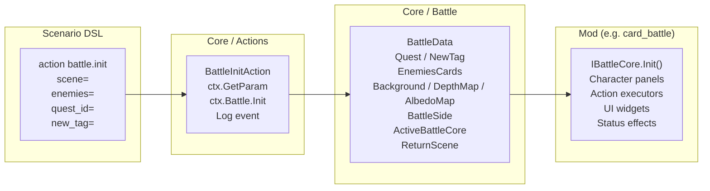
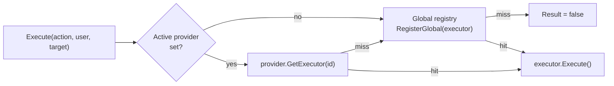

# Battle System

The battle engine is a pluggable, mod-driven system. Each battle ruleset is implemented as a mod (e.g. `card_battle`, `ff_battle`) following the `IBattleCore` interface. Battles are initiated from scenario scripts via `action battle.init`.

## Architecture overview



## Key interfaces

### `IBattleCore` — Combat ruleset

Every battle system mod defines a class implementing `IBattleCore`:

| Member | Description |
|---|---|
| `Id` | Unique string ID used by `battle.set_core` |
| `ActionProvider` | Returns `IActionExecutorProvider` for overriding action executors |
| `Init(Character[] playerChars, Character[] enemyChars, IBattleContext ctx)` | Called when battle starts — sets up UI, spawns enemies |
| `Start()` | Called after Init — begins the battle loop |

### `IActionExecutor` — Ability resolution

Each battle action type (attack, defence, stun, item, etc.) has an executor:

| Member | Description |
|---|---|
| `ActionId` | Unique action identifier |
| `Execute(action, user, target)` | Resolves the action against target |

Executors are registered through `ActionExecutorHub`, which routes actions by ID at runtime.

GDScript mods can register executors as well — a `.gd` file with `get_action_id()` + `execute(action, user, target)` is auto-registered into the global executor registry. See [GDScript in Mods](site/docs/mods/src/gdscript) for the full API.

### `IBattleContext` — Engine bridge

Bridge from the battle core back to the engine so cores stay engine-agnostic:

| Member | Description |
|---|---|
| `ApplyDamage(source, target, rawDamage, defence)` | Applies `max(0, rawDamage - defence)` to the target's Health directly (no event — the UI layer polls) |
| `ScheduleAnimation(IBattleAnimation)` | Schedules visual feedback for playback |
| `EndTurn(BattleSide side)` | Phase signal: the given side ends its turn |
| `EndBattle(BattleSide winner)` | Ends the battle with the given winner |
| `RootNode` | Godot `Node` anchor for instantiating nodes (e.g. damage numbers) |

## Battle initialization flow

1. Scenario runs `action battle.set_core core=card_battle` — selects the ruleset by ID. The registry is a case-sensitive dictionary and **throws on an unknown ID**; built-in IDs are `card_battle` and `ff_battle`
2. Scenario runs `action battle.init scene=... enemies=... quest_id=... new_tag=...`
3. `BattleInitAction` reads dialog variables, calls `BattleService.Init()`
4. `BattleData` captures the current background
5. `BattleData.InitBattle` resolves enemy character IDs to `Character` instances via `CharacterFactory`; unknown IDs get a fallback template character (20 HP, 3 action points)
6. Active `IBattleCore.Init()` is called — mod sets up its UI panels
7. `IBattleCore.Start()` begins the battle loop

**Important**: `battle.init` must run *after* the background has been set in the scenario, otherwise the battle gets a null backdrop.

## Status effects

Status effects (buff, debuff, stun) are applied during battle via the `StatusEffectQueue` on each character. Effects have a duration in turns and expire automatically.

See [Status Effects](../status_effects/) for the JSON definition format.

## Victory screen listeners (winground)

The victory screen (`Winground.tscn`, driven by `WingroundBehaviour`) exposes an extension point for mods that want to modify EXP awards, alter generated loot, or run logic right before the UI appears. Implement `IWingroundListener` (`Core/Battle/IWingroundListener.cs`):

| Member | Description |
|---|---|
| `Id` | Unique identifier (convention: `"mod_id.listener_name"`), used in logs and dependency ordering |
| `OnBeforeExpAward(WingroundContext)` | EXP data is populated but not yet applied to characters; the loot list is still empty |
| `OnAfterLootGenerated(WingroundContext)` | Loot has been rolled from defeated enemies but not yet added to inventory — mutate freely |
| `OnBeforeShow(WingroundContext)` | All processing done; final chance to mutate data before the victory UI is shown |

Hooks fire in that order during `WingroundBehaviour.Show`. The same `WingroundContext` instance is passed through every phase, so mutations made by earlier hooks are visible to later hooks and listeners.

Registration goes through the `WingroundListenerRegistry` singleton:

- **C# mods**: implement `IWingroundListener` with a parameterless constructor — `ModAssemblyLoader` calls `WingroundListenerRegistry.Instance.RegisterAssembly(assembly)`, which discovers and instantiates implementations automatically
- Exceptions thrown by individual listeners are logged and swallowed so one broken mod cannot break the victory screen for others

### `WingroundContext`

Mutable context shared by all listeners (`Core/Battle/WingroundContext.cs`):

| Field | Type | Description |
|---|---|---|
| `PlayerExpGained` | `Dictionary<string, int>` | Per-character EXP earned, keyed by character ID |
| `DefeatedEnemies` | `List<Character>` | Enemies defeated this battle; drives loot generation and recruitment rolls |
| `GeneratedLoot` | `List<ItemContainer>` | Loot items — add, remove, or modify entries before they are committed to inventory |
| `BattleData` | `BattleData` | Reference to the battle descriptor shared with the quest system — do not mutate the object itself |

### GDScript variant

A `.gd` script exposing `get_winground_listener_id()` returning a unique string, plus any of the optional hooks `on_winground_before_exp(ctx)` / `on_winground_after_loot(ctx)` / `on_winground_before_show(ctx)`, is detected by method signature in `ModGDScriptLoader`, wrapped in a `GDWingroundListener`, and registered automatically. All three hooks are optional — only the methods the script actually implements are called.

The C# context is marshalled into a `GDWingroundContext` (`RefCounted`) before each call and synced back afterwards: mutations to `ExpGained` and `GeneratedLoot` propagate to the C# victory pipeline, while `DefeatedEnemies` are exposed as read-only `GDCharacter` DTO snapshots whose changes are *not* written back.

```gdscript
extends RefCounted

func get_winground_listener_id() -> String:
    return "my_mod.double_exp"

func on_winground_before_exp(ctx) -> void:
    for id in ctx.ExpGained:
        ctx.ExpGained[id] *= 2
```

## Battle speed control

`BattleSpeedControl` (`Core/Battle/BattleSpeedControl.cs`) is the x1/x4/x8 toggle bar shown during battle:

| Member | Description |
|---|---|
| `ApplySavedSpeed()` | Restores `Engine.TimeScale` from `GameData.Settings.BattleSpeed` (out-of-range values fall back to x1); called automatically on `_Ready()` |
| `ResetToNormal()` | Resets `Engine.TimeScale` to 1.0 *without* saving — used when the battle ends so menus run at normal speed |

Picking a speed sets `Engine.TimeScale`, which accelerates the entire game loop (not just animations), and persists the choice to `GameData.Settings.BattleSpeed`.

## Animation layer

Visual feedback is decoupled from combat logic so battle cores stay engine-agnostic (`Core/Battle/Adapters/`):

| Type | Role |
|---|---|
| `IBattleAnimation` | Data-only description: `Source`/`Target` characters, `AnimationType` dispatch key, `Speed` multiplier, open-ended `Parameters` dictionary |
| `IBattleAnimationPlayer` | Plays one animation type — `Play(anim, onComplete)` must invoke the callback so the action machine can advance |
| `AnimationRegistry` | Singleton index (`Instance`) keyed by `AnimationType`; `Register()` replaces any existing player for the same key (last write wins), `Get()` looks up |

Executors never play animations directly — they request them via `IBattleContext.ScheduleAnimation(IBattleAnimation)`, and the playback layer resolves the matching player from the registry.

## Executor routing recap

`ActionExecutorHub` resolves an action ID in two tiers:



- **Global tier**: `ActionExecutorHub.Instance.RegisterGlobal(executor)` — the fallback pool, including auto-registered GDScript executors (a `.gd` file with `get_action_id()` + `execute()`)
- **Provider tier**: the active battle core installs per-core overrides via `SetActiveProvider(IActionExecutorProvider)`
- Lookup order: active provider first, global registry as fallback; no match (or a null action) yields `ChangedAttributes { Result = false }`

## Creating a custom battle system mod

1. Create a new mod with `manifest.json`:
```jsonc
   {
     "name": "MyBattle",                                   // Human-readable mod name
     "description": "Custom battle system",                // Short description
     "sources": ["src/**/*.cs"],                           // Glob patterns for C# source files
     "depends": ["core"]                                   // Versioned dependency strings
   }
```

2. Implement `IBattleCore`:
   ```csharp
   public class MyBattleCore : IBattleCore
   {
       public string Id => "MyBattle";
       public IActionExecutorProvider ActionProvider => new MyActionProvider();

       public void Init(Character[] playerChars, Character[] enemyChars, IBattleContext ctx)
       {
           // Create enemy panels, character widgets, action buttons
       }

       public void Start()
       {
           // Begin turn loop
       }
   }
   ```

3. Implement `IActionExecutorProvider` to provide your action executors:
   ```csharp
   public class MyActionProvider : IActionExecutorProvider
   {
       public IActionExecutor GetExecutor(string actionId)
       {
           return actionId switch
           {
               "mybattle.attack" => new MyAttackExecutor(),
               "mybattle.defend" => new MyDefendExecutor(),
               _ => null
           };
       }
   }
   ```

4. In scenarios, select your core before initiating battle:
   ```scenario
   action battle.set_core core=MyBattle
   action battle.init scene=town_entry enemies=wolf_1
   ```

## Battle-related Godot scenes

| Path | Purpose |
|---|---|
| `scenes/battle/Battle.tscn` | Main battle scene container |
| `scenes/battle/Winground.tscn` | Victory screen overlay |
| `scenes/battle/Deadground.tscn` | Defeat screen overlay |
| `scenes/battle/exp_report_card.tscn` | Experience/loot report |

Note the file casing above (`Battle.tscn`, not `battle.tscn`) — it works on Windows but breaks on case-sensitive filesystems.
