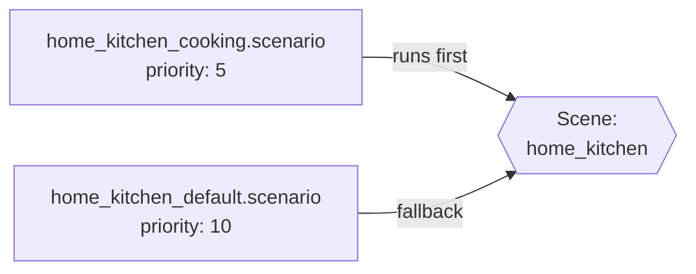

# Scenes

Scene definitions map scene IDs to default backgrounds, ambient music, and entry-point scenarios. Scenes are the navigation graph of the game — the player moves between them.

## JSON structure

```jsonc
{
  "name": "scene_id",                                       // Unique scene identifier (referenced by switch_scene)
  "defaultBackground": "path/to/background",                // Path to background image loaded on scene enter (or array of paths)
  "defaultAmbient": "playlist_id",                          // Playlist ID for background music (empty = no music)
  "defaultScenario": "scenarios/path/to/default.scenario"   // Scenario file that runs when the scene loads
}
```

## Field reference

| Field | Description |
|---|---|
| `name` | Unique scene identifier (e.g. `home_kitchen`, `town_entry`). Referenced by `switch_scene` in DSL |
| `defaultBackground` | Path to the background image loaded on scene enter (relative to `backgrounds/`). Can be a single string or an array of strings for multiple backgrounds |
| `defaultAmbient` | Playlist ID for background music (from `music/playlists/`). Empty string = no music |
| `defaultScenario` | Path to the scenario file that runs when the scene loads (relative to mod root) |

## Real examples

From `mods/cthangover_game/scenes/`:

```jsonc
{
  "name": "home_kitchen",                                 // Scene ID — used with switch_scene and ui[] entries
  "defaultBackground": "home/kitchen",                    // Background image path (relative to backgrounds/)
  "defaultAmbient": "",                                   // No ambient music for this scene
  "defaultScenario": "scenarios/home/home_kitchen_default.scenario"  // Entry-point scenario
}
```

```jsonc
{
  "name": "home_vestibule",                                   // Scene ID — vestibule/entrance of the player's home
  "defaultBackground": "home/vestibule",                      // Background image path (relative to backgrounds/)
  "defaultAmbient": "",                                       // No ambient music for this scene
  "defaultScenario": "scenarios/home/home_vestibule_default.scenario"  // Entry-point scenario
}
```

## Scene navigation

Scenes are connected through the `switch_scene` DSL command:

```scenario
switch_scene home_vestibule
end
```

And through `option` jumps that lead to `switch_scene`:

```scenario
select "[Where to?]" key=home_outside/prompt
option "Enter the house" key=home_outside/opt_enter -> :enter
option "To the town" key=home_outside/opt_town -> :town

:enter
switch_scene home_vestibule
end

:town
switch_scene town_entry
end
```

## Scene lifecycle

When the player enters a scene, the engine:

1. Collects the scene's events — `.scenario` files targeting the scene plus `[SceneEvent]` C# classes (see [Scene Event Metadata](../metadata/)) — and sorts them by `priority` with `after:` dependencies resolved
2. Publishes the `scene_entered` lifecycle event on the [Event Bus](../events/); engine subscribers apply `defaultBackground` (subscriber priority 0), start `defaultAmbient` (5), and update the music type (10)
3. Evaluates every event's `condition:` and enqueues the passing scenarios into the scene's event chain, where they run one after another in enqueue order
4. If no events are registered at all, falls back to the scene's `defaultScenario`
5. When leaving, publishes `scene_exited`

## Hooking into scenes from mods

There is no manifest subscription list; mods extend a scene in one of three ways:

- **A `.scenario` file targeting the scene** — the most common hook. The Cooking mod adds a "Cook" option to the kitchen with a `home_kitchen` scenario at a lower `priority` than the core's default one.
- **A `[SceneEvent]` C# class** — declarative code hook compiled into the mod assembly; runs in the same event chain as scenarios (see [Scene Event Metadata](../metadata/)).
- **A manifest `ui` entry bound to the scene** — panels and overlays declared in `manifest.json` accept a `"scene": "home_kitchen"` field; the element is then only available in that scene and is hidden when the player leaves it.

## Scenario priority system

Multiple `.scenario` files can target the same `scene:`. The one with the **lowest** `priority` number runs first. If that scenario's `condition:` is unmet, the next-highest priority scenario is tried.



This allows mods to extend scenes non-destructively by writing additional scenario files with lower priority numbers.

## Adding a new scene

1. Create `scenes/{name}.json` with background, playlist, and default scenario
2. Create the background image(s) in `backgrounds/{name}/`
3. Write the default scenario in `scenarios/{path}.scenario`
4. Add `switch_scene {name}` commands to an existing scene to create a navigation path
5. Register a `[SceneEvent]` class, add extra `.scenario` files targeting the scene, or declare a `ui` entry with `"scene": "{name}"` in your manifest if needed
