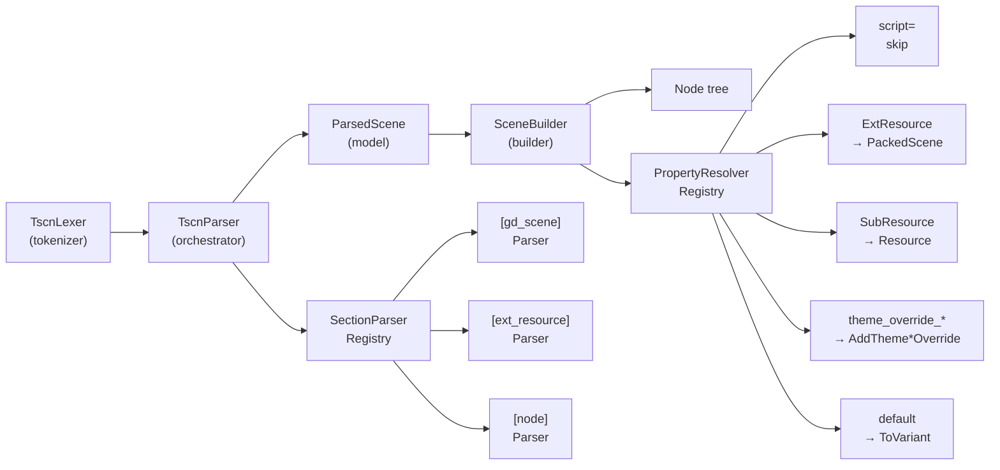
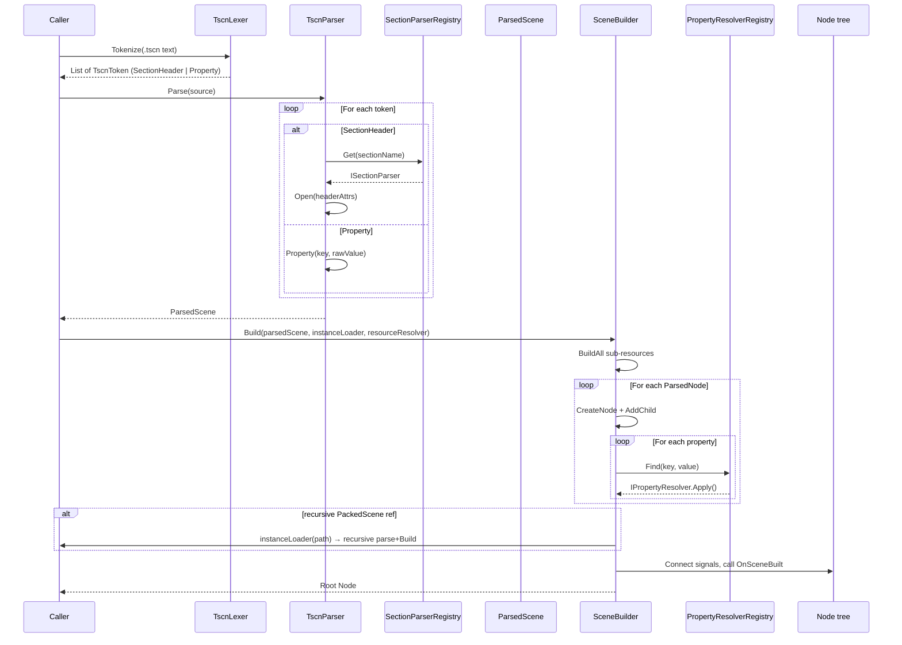

# Runtime TSCN Scene Loading

Godot `.tscn` scene files can be loaded and instantiated at runtime — after the game is built — through a custom parser and builder. This is the primary mechanism for mods to ship pre-authored Godot scenes that are constructed identically to how Godot itself would build them.

## Why a custom parser?

Godot's native `PackedScene` loading (`ResourceLoader.Load<PackedScene>(path)`) requires the scene to be present as a file on disk. Mods distributed as `.zip` archives cannot use this path. The custom parser reads `.tscn` text through `IModFileProvider` — the same abstract file backend that serves all other mod assets (textures, scenarios, JSON). This means scenes work identically whether the mod is a loose folder or a compressed archive.

## Architecture



Both `SectionParserRegistry` and `PropertyResolverRegistry` use `Reflections.FindAndCreate<T>()` auto-discovery — any assembly can register new section or property handlers without modifying existing code.

## Loading pipeline



## TSCN format reference

### `[gd_scene ...]`

```ini
[gd_scene format=3]                    ; uid= and load_steps= ignored
```

### `[ext_resource ...]`

```ini
[ext_resource type="Script" path="scripts/MyScript.cs" id="1_script"]
[ext_resource type="PackedScene" path="scenes/dialog.tscn" id="2_dialog"]
```

| Attribute | Required | Notes |
|---|---|---|
| `type` | Yes | `"Script"` and `"PackedScene"` drive node creation and recursive instancing; other types (e.g. `"Texture2D"`) resolve through the ext-resource builder registry |
| `path` | Yes | Mod-relative path. Resolved through mod priority system across all loaded mods. The editor's on-disk form (`res://mods/<mod>/...`) is normalised to the same mod-relative key, so editor-authored scenes work unchanged |
| `id` | Yes | Local identifier within this scene file |
| `uid` | No | Ignored (build-time identifier, inaccessible after build) |

### `[node ...]`

```ini
[node name="Root" type="Control" groups=["my_group"]]
anchor_right = 1.0
script = ExtResource("1_script")

[node name="Child" parent="." instance=ExtResource("2_dialog")]
visible = false

[node name="DeepChild" parent="Root/Panel" type="Label"]
text = "Hello"
theme_override_font_sizes/font_size = 14        ; applied via AddThemeFontSizeOverride
metadata/_tab_index = 0                          ; editor metadata — IGNORED
```

| Attribute | Required | Notes |
|---|---|---|
| `name` | Yes | Node name |
| `type` | No | Godot class name (`Control`, `Button`, `Label`, etc.). Not needed when `instance=` is present |
| `parent` | No | `"."` = root node; `"Name"` or `"Name/Child"` = explicit parent. Omitted for root node |
| `instance` | No | `ExtResource("id")` — recursively parses and builds the referenced `.tscn` |
| `script` | No | `ExtResource("id")` — resolves to C# type via mod priority system, creates node via `Activator.CreateInstance(type)` |
| `groups` | No | `["group1", "group2"]` — adds node to Godot groups |
| `node_paths` | No | `PackedStringArray("var1", "var2")` — declares which properties are NodePath editor bindings |
| `unique_id` | No | Ignored (editor-only annotation) |

### `[sub_resource ...]`

```ini
[sub_resource type="StyleBoxFlat" id="style_1"]
bg_color = Color(0.1, 0.2, 0.3, 1)
corner_radius_top_left = 4
```

Built-in builders support: `StyleBoxFlat`, `StyleBoxEmpty`, `ShaderMaterial`, `ImageTexture`, `Gradient`, `GradientTexture1D`, `Curve`, `FontFile` (and `Font` alias).

Custom types are added by implementing `ISubResourceBuilder` — auto-discovered via `Reflections.FindAndCreate<T>()`.

### `[connection ...]`

```ini
[connection signal="pressed" from="MyButton" to="." method="OnPressed" flags=0]
```

| Attribute | Required | Notes |
|---|---|---|
| `signal` | Yes | Signal name on the source node |
| `from` | Yes | Source node name (relative to root) |
| `to` | Yes | Target node — **only `"."` (root) connections are applied**. Connections to animation players, visual effects, etc. are skipped |
| `method` | Yes | Method name on the target node |
| `flags` | No | Godot connect flags (default 0) |
| `binds` | No | Not supported |
| `unbinds` | No | Not supported |

## Entry point system

Any root node can declare an entry-point class via a special property:

```ini
[node name="MyScene" type="Control"]
__entry_point = "MyMod.EntryPointClass"
```

The class must implement `ITscnSceneEntryPoint`:

```csharp
public interface ITscnSceneEntryPoint
{
    void OnSceneBuilt(Node sceneRoot);
}
```

The entry point is resolved across all loaded assemblies — mod-compiled code first, then `Type.GetType()`, then all `AppDomain` assemblies as fallback. `OnSceneBuilt` is called after the entire node tree is constructed, properties are applied, and signals are connected.

## PackedScene resolution

When a node has `instance=ExtResource("id")`, the parser:

1. Looks up the `ext_resource` by id to find the `.tscn` path
2. Searches all mods in priority order for the file (same as script resolution)
3. Recursively parses and builds the sub-scene
4. Applies any override properties from the parent node (`visible = false` etc.)

```ini
; Parent scene
[ext_resource type="PackedScene" path="scenes/dialog.tscn" id="2_dialog"]
[node name="Dialog" parent="." instance=ExtResource("2_dialog")]
visible = false                    ; ← overwrites dialog.tscn root visibility
```

When a node property references a PackedScene (not via `instance=` but as an exported field):

```ini
answerBoxScene = ExtResource("2_answerbox")
```

The builder resolves it recursively, packs the result into a `PackedScene` via `PackedScene.Pack()`, and sets the property. This enables scripts with `[Export] PackedScene` fields to work identically to Godot's native loading.

## Mod priority resolution

Both script paths and PackedScene paths are resolved through the mod priority system:

```
.tscn: path="scripts/MyScript.cs"
   → ScriptTypeRegistry: search all mods in load-order priority
   → First mod where the file exists (or the type is registered) wins
```

This is the same mechanism used by `ModRegistry` for asset deduplication. A mod with higher priority can override a scene dependency from another mod.

## Property value types supported

| TSCN value | Parsed output | Godot type (build time) |
|---|---|---|
| `null` | `null` | `Variant` null |
| `true` / `false` | `bool` | `bool` |
| `42` | `int` | `int` |
| `1.0` | `float` | `float` |
| `"text"` | `string` | `string` |
| `NodePath("path")` | `ParsedGodotValue("NodePath", "path")` | `Godot.NodePath` |
| `StringName("name")` | `ParsedGodotValue("StringName", "name")` | `Godot.StringName` |
| `Vector2(1, 2)` | `ParsedGodotValue("Vector2", 1f, 2f)` | `Godot.Vector2` |
| `Vector2i(1, 2)` | `ParsedGodotValue("Vector2i", 1f, 2f)` | `Godot.Vector2I` |
| `Vector3(1, 2, 3)` | `ParsedGodotValue("Vector3", 1f, 2f, 3f)` | `Godot.Vector3` |
| `Vector3i(1, 2, 3)` | `ParsedGodotValue("Vector3i", 1f, 2f, 3f)` | `Godot.Vector3I` |
| `Vector4(1, 2, 3, 4)` | `ParsedGodotValue("Vector4", 1f, 2f, 3f, 4f)` | `Godot.Vector4` |
| `Vector4i(1, 2, 3, 4)` | `ParsedGodotValue("Vector4i", 1f, 2f, 3f, 4f)` | `Godot.Vector4I` |
| `Color(0, 0, 0, 1)` | `ParsedGodotValue("Color", 0f, 0f, 0f, 1f)` | `Godot.Color` |
| `Rect2(0, 0, 100, 200)` | `ParsedGodotValue("Rect2", 0f, 0f, 100f, 200f)` | `Godot.Rect2` |
| `Rect2i(0, 0, 100, 200)` | `ParsedGodotValue("Rect2i", 0f, 0f, 100f, 200f)` | `Godot.Rect2I` |
| `Transform2D(1,0,0,1,0,0)` | `ParsedGodotValue("Transform2D", ...)` | `Godot.Transform2D` |
| `Plane(0, 0, 0, 0)` | `ParsedGodotValue("Plane", 0f, 0f, 0f, 0f)` | `Godot.Plane` |
| `Quaternion(0, 0, 0, 1)` | `ParsedGodotValue("Quaternion", 0f, 0f, 0f, 1f)` | `Godot.Quaternion` |
| `AABB(0, 0, 0, 1, 1, 1)` | `ParsedGodotValue("AABB", 0f, 0f, 0f, 1f, 1f, 1f)` | `Godot.Aabb` |
| `ExtResource("id")` | `TscnPropertyValue(ExtResource)` | Resolved at build time |
| `SubResource("id")` | `TscnPropertyValue(SubResource)` | Resolved at build time |
| `PackedStringArray("a","b")` | `string[]` | `Godot.Collections.Array<string>` |
| `PackedInt32Array(1, 2)` | `int[]` | `Godot.Collections.Array<int>` |
| `PackedInt64Array(1, 2)` | `long[]` | `Godot.Collections.Array<long>` |
| `PackedFloat32Array(1.5, 2.5)` | `float[]` | `Godot.Collections.Array<float>` |
| `PackedFloat64Array(1.5, 2.5)` | `double[]` | `Godot.Collections.Array<double>` |
| `PackedByteArray(0, 255)` | `byte[]` | `Godot.Collections.Array<byte>` |
| `PackedVector2Array(1, 2, 3, 4)` | `ParsedGodotValue[]` | `Godot.Collections.Array<Vector2>` |
| `PackedVector3Array(1, 2, 3, 4, 5, 6)` | `ParsedGodotValue[]` | `Godot.Collections.Array<Vector3>` |
| `PackedColorArray(1, 0, 0, 1, 0, 1, 0, 1)` | `ParsedGodotValue[]` | `Godot.Collections.Array<Color>` |

Godot native objects are deliberately **not** created during parsing — `TscnPropertyParser` returns lightweight `ParsedGodotValue` wrappers. Conversion to actual `Godot.Variant` happens only in `SubResourceFactory.ToVariant()` at build time, inside the Godot runtime.

## What is intentionally NOT supported

| Feature | Reason |
|---|---|
| `uid="..."` on all sections | Build-time identifiers; mod scenes are not preprocessed by Godot |
| `load_steps=N` | Editor metadata |
| `unique_id=N` on nodes | Editor annotation for scene diffing |
| `[editable ...]` | Editor-only placeholder for inherited scenes |
| `theme_override_*` (nested properties like `theme_override_constants/separation`) | Applied for plain values through `AddTheme*Override`; overrides whose value is an `ExtResource(...)`/`SubResource(...)` reference are not applied |
| `metadata/*` | Editor metadata only |
| `connection` with `to != "."` | Non-script connections (animation callbacks, visual tweens) |
| `binds=` / `unbinds=` on connections | Not used in any scene in this project |
| `owner=` on nodes | Editor concept irrelevant for mod-constructed scenes |
| `format=2` (Godot 3.x scenes) | Project targets Godot 4.x |
| Binary `.scn` format | Only text `.tscn` is supported |

## Adding a scene to a mod

1. Create `scenes/my_scene.tscn` in your mod directory
2. Use standard Godot editor to author the scene (the same file works in both editor and runtime)
3. Set `__entry_point = "MyMod.EntryClass"` on the root node
4. Implement `ITscnSceneEntryPoint` in your mod's C# code:

```csharp
using Cthangover.Core.Scenes;
using Godot;

namespace MyMod
{
    public class EntryClass : Node, ITscnSceneEntryPoint
    {
        public void OnSceneBuilt(Node sceneRoot)
        {
            var button = sceneRoot.GetNodeOrNull<Button>("StartButton");
            button?.Connect("pressed", Callable.From(OnStart));
        }

        private void OnStart() { /* ... */ }
    }
}
```

5. In your mod code, load and build:

```csharp
var sceneNode = TscnScenes.LoadAndBuild("scenes/my_scene.tscn");
GetParent().AddChild(sceneNode);
```

`TscnScenes.LoadAndBuild(string scenePath)` takes a single argument — the mod-relative scene path. There is no mod ID parameter: the resolver locates the owning mod by looking up which loaded mod contains that file, walking mods in load-order priority.

## Extending the parser

### Adding a new section type

Implement `ISectionParser`:

```csharp
public class MyCustomSectionParser : ISectionParser
{
    public string SectionType => "my_custom";

    public void Open(Dictionary<string, string> headerAttrs) { /* parse header */ }
    public void Property(string key, string rawValue) { /* handle properties */ }
    public void Close(ParsedScene scene) { /* commit results */ }
}
```

Auto-discovered. No registration code needed.

### Adding a new property handler

Implement `IPropertyResolver`:

```csharp
public class MyPropResolver : IPropertyResolver
{
    public bool CanResolve(string key, object value)
        => value is ParsedGodotValue pgv && pgv.TypeName == "MyType";

    public void Apply(Node node, string key, object value, PropertyContext ctx)
        => node.Set(key, /* my logic */);
}
```

### Adding a new sub-resource builder

Implement `ISubResourceBuilder`:

```csharp
public class MyResourceBuilder : ISubResourceBuilder
{
    public string ResourceType => "MyResourceType";

    public Resource Build(SubResourceDef def, SubResourceBuildContext ctx)
        => /* create and configure */;
}
```
